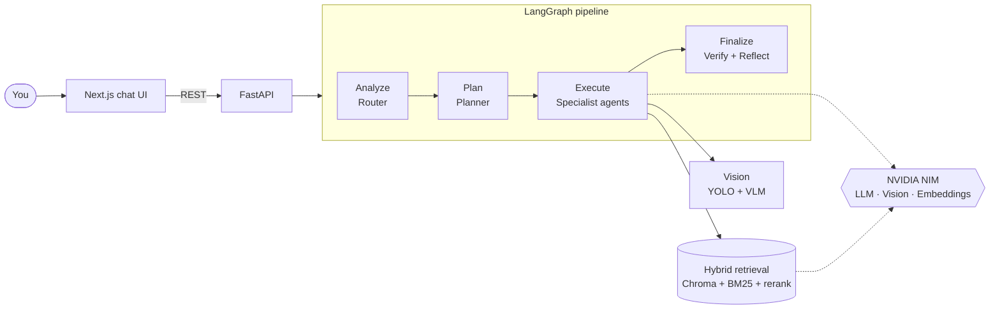

<div align="center">

# 🧠 Nexus AI

### Chat with your documents. A team of AI agents plans, retrieves, answers, and fact-checks.

Multi-agent RAG on **LangGraph** + **NVIDIA NIM**, with a fast **FastAPI** backend and a slick **Next.js** chat UI.
Ask questions, compare files, extract tables, write code, and detect objects in images, all from one place.

[](https://github.com/Karthikps84/nexus_ai_multi-agent_rag/actions/workflows/ci.yml)


[](LICENSE)

**If Nexus saves you time, a ⭐ helps other people find it.**

</div>

<!-- Add a demo GIF or screenshot here once you have one:
<p align="center"></p>
-->

---

## ✨ Why Nexus?

Most "chat with your PDF" demos are one prompt stuffed with a few chunks. Nexus is built like a small team instead:

| 🧩 Agent | What it does |
|---|---|
| **Router** | Reads your question and picks the right route: Q&A, summarize, compare, table extraction, code, or image |
| **Planner / Supervisor** | Breaks multi-part questions into steps and checks each step's output |
| **Retrieval** | Hybrid search: dense vectors + BM25, fused and re-ranked, so exact terms *and* meaning both work |
| **Specialists** | QA, Summarizer, Comparison, Table, Coding, Image, and a real YOLO vision-analysis agent |
| **Verifier + Reflection** | Scores the answer against the retrieved sources and re-checks weak answers |
| **Memory** | Keeps conversation history so follow-ups like "explain more about it" just work |

## 🚀 Features

- 📚 **Chat with PDFs, Word, Excel, PowerPoint, CSV, Markdown, text and images**
- 🔎 **Hybrid retrieval** (Chroma + BM25 + re-rank + MMR) with inline `[file p.X]` citations
- ⚡ **Incremental indexing**: add a file and only that file is embedded. Remove or edit one and only its chunks change
- 🗂️ **Indexed-docs panel**: see what's indexed, watch new uploads appear, click a file to scope your question to it
- 🖼️ **Vision tools**: attach an image to detect objects (YOLO with drawn boxes) or ask / classify it with a vision-language model
- 🎨 **Polished chat UI**: Markdown answers, tables and code blocks, citation chips, typing indicator, dark mode
- 🧪 **Quality built in**: RAGAS / DeepEval evaluation scripts, response and retrieval caching, optional LangSmith tracing
- 🔁 **Real CI/CD**: lint + tests on every PR, automatic semantic versioning, changelog, and versioned Docker images on GHCR

## 🏗️ How it works



Everything model-related runs on **NVIDIA NIM** with a single `NVIDIA_API_KEY`: the LLMs, the vision model, and the embeddings.

## ⚡ Quick start

You need **Python 3.12+**, **Node 20+**, [`uv`](https://docs.astral.sh/uv/), and a free key from [build.nvidia.com](https://build.nvidia.com).

```bash
git clone https://github.com/Karthikps84/nexus_ai_multi-agent_rag.git
cd nexus_ai_multi-agent_rag/local_lama_rag

# 1. configure
cp .env.example .env          # then put your NVIDIA_API_KEY in .env

# 2. backend  (http://localhost:8000)
uv sync
uv run uvicorn api.main:app --reload

# 3. frontend (http://localhost:3000), in a second terminal
cd frontend
npm install
npm run dev
```

Open **http://localhost:3000** and try *"What is Nexus AI?"*: a tiny sample doc ships in `data/` so the first run works.
Then drop in your own documents with the **+** button. Only new or changed files are embedded, and your documents and index stay local (`data/` and `storage/` are git-ignored).

<details>
<summary><b>Other ways to run it</b></summary>

```bash
uv run streamlit run app.py     # the original Streamlit UI
uv run python main.py           # interactive CLI
```

Pre-built images are published on every release:

```bash
docker pull ghcr.io/karthikps84/nexus_ai_multi-agent_rag-api:latest
docker pull ghcr.io/karthikps84/nexus_ai_multi-agent_rag-web:latest
```
</details>

## ⚙️ Configuration

All knobs live in [`local_lama_rag/config.py`](local_lama_rag/config.py):

| Setting | What it controls |
|---|---|
| `LLM_MODEL` / `FAST_LLM_MODEL` | Models for code tasks and for everything else |
| `VISION_MODEL`, `EMBEDDING_MODEL` | Vision-language and embedding models |
| `SIMILARITY_THRESHOLD`, `SIMILARITY_TOP_K`, `FINAL_TOP_K` | How aggressively retrieval filters chunks |
| `ENABLE_HYBRID_SEARCH`, `ENABLE_RERANK`, `USE_MMR` | Retrieval pipeline stages |
| `VERIFY_ANSWERS`, `ENABLE_REFLECTION` | Answer fact-checking |
| `MODEL_ROUTING` | Which model tier serves which task |

Free NIM endpoints vary a lot in speed. The defaults were picked from live latency tests, so re-check them if responses feel slow.

## 🧪 Development

```bash
cd local_lama_rag
uv run ruff check .      # lint
uv run pytest -q         # tests (no API keys needed)
cd frontend && npm run lint && npm run build
```

Contributions are welcome. Open a PR with a [Conventional Commit](https://www.conventionalcommits.org) title such as `feat: ...` or `fix: ...`.
CI checks it, and [release-please](https://github.com/googleapis/release-please) turns merged commits into versioned releases, a changelog, and Docker images.

## 🗺️ Roadmap

- [ ] Streaming answers in the chat UI
- [ ] Delete documents from the UI
- [ ] Multi-user sessions with per-user indexes
- [ ] One-click deploy

## 📄 License

Released under the [MIT License](LICENSE).

---

<div align="center">

Built with LangGraph · NVIDIA NIM · FastAPI · Next.js

⭐ **Star the repo** if you find it useful, and open an issue if you hit a snag.

</div>
